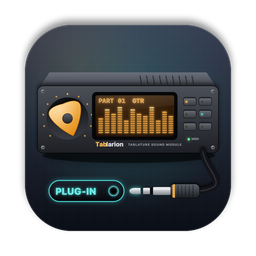
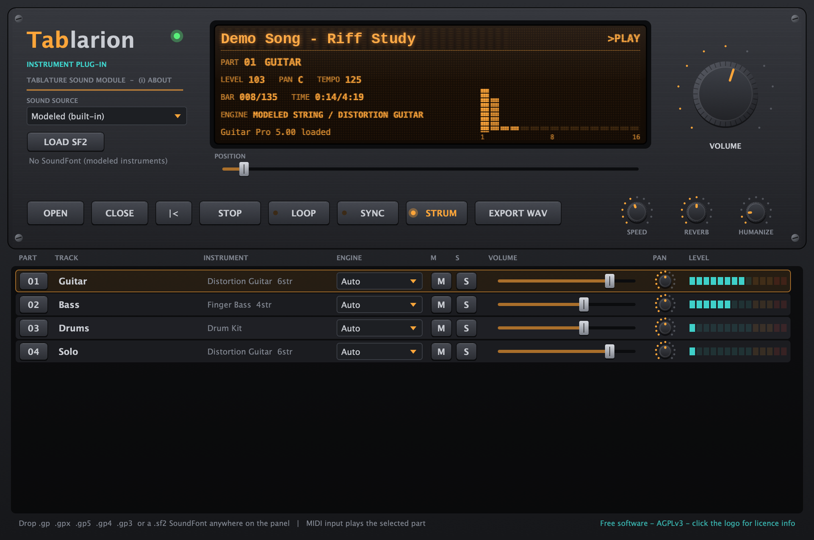

<p align="center">
  <a href="README.md">한국어</a> · <a href="README.en.md">English (US)</a> · <b>English (UK)</b> · <a href="README.zh-CN.md">简体中文</a> · <a href="README.ja.md">日本語</a> · <a href="README.fr.md">Français</a>
</p>

<p align="center">
  
</p>

<h1 align="center">Tablarion</h1>

<p align="center">
  A macOS virtual instrument that plays Guitar Pro tabs · VST3 / AU / Standalone<br>
  <a href="https://github.com/jayusop/Tablarion/releases/latest/download/Tablarion-macOS.zip"><b>⬇ Download Latest</b></a> ·
  <a href="https://jayusop.github.io/Tablarion/?lang=en-GB">Website</a> ·
  <a href="https://github.com/jayusop/Tablarion-source">Source code</a>
</p>

<p align="center">
  
  
  
  
</p>

<p align="center">
  
</p>

---

A free virtual instrument that opens Guitar Pro files (.gp, .gpx, .gp5, .gp4, .gp3) and plays them with an articulation-aware engine — **hammer-ons, slides, bends, harmonics** and more. It has modelled guitars and basses with a voice per string, pianos, organs, ensembles and a synthesised drum kit, and **every sound is synthesised in code; no samples are shipped**.

> Requirements: macOS 12 or later · universal binary (native on Apple Silicon and Intel)

## Installation

1. Download `Tablarion-macOS.zip` from [Releases](https://github.com/jayusop/Tablarion/releases/latest) and unzip it.
2. Copy only the formats you use. In Finder, press <kbd>⌘⇧G</kbd> to open a folder by path.

   | File | Copy to |
   |---|---|
   | `Tablarion.vst3` | `~/Library/Audio/Plug-Ins/VST3` |
   | `Tablarion.component` | `~/Library/Audio/Plug-Ins/Components` (Logic, GarageBand) |
   | `Tablarion.app` | `/Applications` (runs without a DAW) |

3. This is a personal build that isn't notarised by Apple, so macOS says it is damaged or from an unidentified developer. Clear the quarantine flag in Terminal:
   ```bash
   xattr -dr com.apple.quarantine ~/Library/Audio/Plug-Ins/VST3/Tablarion.vst3
   xattr -dr com.apple.quarantine ~/Library/Audio/Plug-Ins/Components/Tablarion.component
   xattr -dr com.apple.quarantine /Applications/Tablarion.app
   ```
4. Restart or rescan your DAW and insert **Tablarion** on an instrument track. If the AU doesn't show up, check it with `auval -v aumu Tbln Tblr`.

## Features

| Area | Features |
|---|---|
| Scores | Independent readers for GP3, GP4, GP5, GP6 (.gpx) and GP7/8 (.gp). Drop onto the panel or click OPEN; CLOSE to unload |
| Articulations | Repeats and endings, tempo map, hammer-on/pull-off, slides, bends and whammy, vibrato, harmonics, trills, tremolo picking, grace notes, strumming (STRUM), swing, humanise |
| Strings | Dual-polarisation waveguide physical model, a voice per string, palm mute, dead notes, pickup position |
| Other instruments | Modal piano, FM e-piano, drawbar organ, string and brass ensembles, synths, synthesised GM drum kit with hi-hat choke |
| Effects | 4× oversampled amp sims with cabinet, acoustic body, chorus, compressors, FDN hall reverb, limiter |
| SoundFont | Load SF2 banks (button, drag and drop or auto-load), Hybrid mode (modelled guitars and basses, SF2 for the rest), per-track engine |
| DAW | SYNC follows transport and tempo, MIDI input plays the selected part, EXPORT WAV renders the song to 24-bit WAV |
| Practice | Speed 25–200 %, loop, position, per-track mute, solo, volume and pan |

### Tablarion GM SoundFont (optional)

A General MIDI bank (about 640 MB) rendered from Tablarion's own modelled instruments: 128 GM programs and a GM drum kit, with no third-party samples. Download `Tablarion-GM.sf2` from [Releases](https://github.com/jayusop/Tablarion/releases/latest) and put it in `~/Library/Application Support/Tablarion/SoundFonts`; it loads automatically on start-up.

## Source code

Tablarion is free software. The complete source code is published at **[jayusop/Tablarion-source](https://github.com/jayusop/Tablarion-source)**. For build instructions see the source repository's README and the [website](https://jayusop.github.io/Tablarion/?lang=en-GB#build).

## Licence

Free software under the **GNU Affero General Public License v3.0 or later (AGPL-3.0-or-later)**.

- Free to use for personal and commercial work. **Music and audio you make with it are yours**, with no licence obligations.
- Redistributing the binaries requires providing the complete corresponding source (or a link to it) together with `LICENSE` and `THIRD_PARTY_LICENSES.txt`.
- Modified versions may only be distributed under the AGPL-3.0 and must state that they were modified.
- Provided "as is" without warranty of any kind. No personal data is collected.

The AGPL is used because Tablarion is built on the JUCE framework (AGPLv3 option) and the Steinberg VST3 SDK (GPLv3 option). All other third-party components (Apple AudioUnitSDK, zlib, libpng, IJG libjpeg, FLAC, Ogg Vorbis, HarfBuzz, SheenBidi) use permissive licences. This software is based in part on the work of the Independent JPEG Group.

Full texts: [LICENSE](LICENSE) · [THIRD_PARTY_LICENSES.txt](THIRD_PARTY_LICENSES.txt) · [Licence details](https://jayusop.github.io/Tablarion/licenses.html?lang=en-GB)

VST is a registered trademark of Steinberg Media Technologies GmbH. Audio Units and macOS are trademarks of Apple Inc. Guitar Pro is a trademark of Arobas Music. SoundFont is a registered trademark of Creative Technology Ltd. These names describe compatibility only; Tablarion is an independent project, not affiliated with or endorsed by these companies. No Guitar Pro software, code or sounds are included.

## Contact

- Bug reports and suggestions: [Issues](https://github.com/jayusop/Tablarion/issues) · email jayusop@gmail.com
