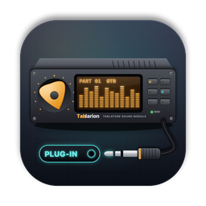
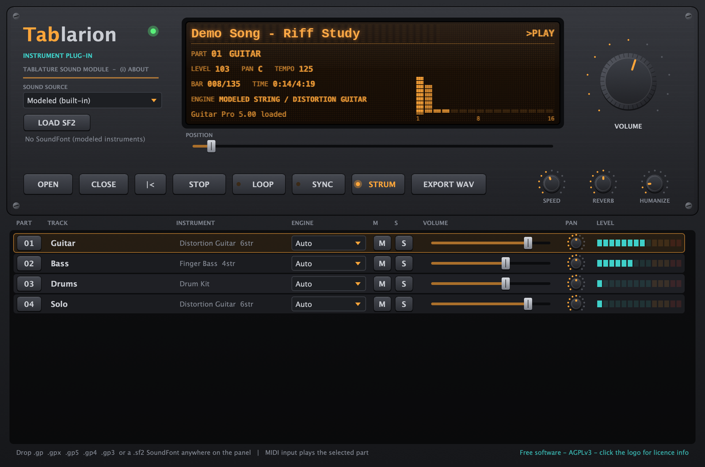

<p align="center">
  <a href="README.md">한국어</a> · <a href="README.en.md">English (US)</a> · <a href="README.en-GB.md">English (UK)</a> · <a href="README.zh-CN.md">简体中文</a> · <a href="README.ja.md">日本語</a> · <b>Français</b>
</p>

<p align="center">
  
</p>

<h1 align="center">Tablarion</h1>

<p align="center">
  Instrument virtuel macOS qui joue les tablatures Guitar Pro · VST3 / AU / Standalone<br>
  <a href="https://github.com/jayusop/Tablarion/releases/latest/download/Tablarion-macOS.zip"><b>⬇ Télécharger la dernière version</b></a> ·
  <a href="https://jayusop.github.io/Tablarion/?lang=fr">Site web</a> ·
  <a href="https://github.com/jayusop/Tablarion-source">Code source</a>
</p>

<p align="center">
  
  
  
  
</p>

<p align="center">
  
</p>

---

Un instrument virtuel gratuit qui ouvre les fichiers Guitar Pro (.gp, .gpx, .gp5, .gp4, .gp3) et les joue en interprétant les techniques de jeu — **hammer-on, glissés, bends, harmoniques** et bien d’autres. Il intègre des guitares et basses à modélisation physique avec une voix par corde, des pianos, des orgues, des ensembles et une batterie synthétisée, et **tous les sons sont synthétisés par le code : aucun échantillon n’est fourni**.

> Configuration requise : macOS 12 ou ultérieur · binaire universel (natif sur Apple Silicon et Intel)

## Installation

1. Téléchargez `Tablarion-macOS.zip` depuis la page [Releases](https://github.com/jayusop/Tablarion/releases/latest) et décompressez-le.
2. Copiez uniquement les formats que vous utilisez. Dans le Finder, <kbd>⌘⇧G</kbd> ouvre un dossier par son chemin.

   | Fichier | Copier dans |
   |---|---|
   | `Tablarion.vst3` | `~/Library/Audio/Plug-Ins/VST3` |
   | `Tablarion.component` | `~/Library/Audio/Plug-Ins/Components` (Logic, GarageBand) |
   | `Tablarion.app` | `/Applications` (fonctionne sans DAW) |

3. Il s’agit d’une version personnelle non notariée par Apple : macOS indique qu’elle est endommagée ou provient d’un développeur non identifié. Supprimez l’attribut de quarantaine dans le Terminal :
   ```bash
   xattr -dr com.apple.quarantine ~/Library/Audio/Plug-Ins/VST3/Tablarion.vst3
   xattr -dr com.apple.quarantine ~/Library/Audio/Plug-Ins/Components/Tablarion.component
   xattr -dr com.apple.quarantine /Applications/Tablarion.app
   ```
4. Redémarrez votre DAW ou relancez l’analyse des plug-ins, puis insérez **Tablarion** sur une piste d’instrument. Si l’AU n’apparaît pas, vérifiez-la avec `auval -v aumu Tbln Tblr`.

## Fonctionnalités

| Domaine | Fonctionnalités |
|---|---|
| Partitions | Lecteurs indépendants pour GP3, GP4, GP5, GP6 (.gpx) et GP7/8 (.gp). Glisser-déposer sur le panneau ou OPEN ; CLOSE pour fermer |
| Techniques | Reprises et fins alternatives, carte de tempo, hammer-on/pull-off, glissés, bends et vibrato au levier, vibrato, harmoniques, trilles, trémolo, notes d’ornement, grattage (STRUM), swing, humanisation |
| Cordes | Modèle physique à guide d’ondes à double polarisation, une voix par corde, palm mute, notes étouffées, position du micro |
| Autres instruments | Piano modal, piano électrique FM, orgue à tirettes, ensembles de cordes et de cuivres, synthés, batterie GM synthétisée avec étouffement du charleston |
| Effets | Simulations d’ampli suréchantillonnées 4× avec baffle, caisse acoustique, chorus, compresseurs, réverbération de salle FDN, limiteur |
| SoundFont | Chargement de banques SF2 (bouton, glisser-déposer ou chargement auto), mode Hybrid (guitares et basses modélisées, SF2 pour le reste), moteur par piste |
| DAW | SYNC suit le transport et le tempo, l’entrée MIDI joue la partie sélectionnée, EXPORT WAV rend le morceau en WAV 24 bits |
| Travail | Vitesse 25–200 %, boucle, position, mute, solo, volume et panoramique par piste |

### Tablarion GM SoundFont (facultatif)

Une banque General MIDI (environ 640 Mo) rendue à partir des instruments modélisés de Tablarion : 128 programmes GM et une batterie GM, sans aucun échantillon tiers. Téléchargez `Tablarion-GM.sf2` depuis [Releases](https://github.com/jayusop/Tablarion/releases/latest) et placez-le dans `~/Library/Application Support/Tablarion/SoundFonts` ; il se charge automatiquement au démarrage.

## Code source

Tablarion est un logiciel libre. Le code source complet est publié sur **[jayusop/Tablarion-source](https://github.com/jayusop/Tablarion-source)**. Pour la compilation, consultez le README du dépôt source et le [site web](https://jayusop.github.io/Tablarion/?lang=fr#build).

## Licence

Logiciel libre et gratuit distribué sous la **GNU Affero General Public License v3.0 ou ultérieure (AGPL-3.0-or-later)**.

- Utilisation gratuite pour un usage personnel comme commercial. **La musique et l’audio que vous créez avec ce plug-in vous appartiennent**, sans aucune obligation de licence.
- Pour redistribuer les binaires, il faut fournir le code source correspondant complet (ou un lien vers celui-ci) ainsi que `LICENSE` et `THIRD_PARTY_LICENSES.txt`.
- Les versions modifiées ne peuvent être distribuées que sous AGPL-3.0 et doivent indiquer qu’elles ont été modifiées.
- Fourni « tel quel », sans aucune garantie. Aucune donnée personnelle n’est collectée.

L’AGPL est utilisée parce que Tablarion repose sur le framework JUCE (option AGPLv3) et le SDK VST3 de Steinberg (option GPLv3). Tous les autres composants tiers (Apple AudioUnitSDK, zlib, libpng, IJG libjpeg, FLAC, Ogg Vorbis, HarfBuzz, SheenBidi) sont sous licences permissives. This software is based in part on the work of the Independent JPEG Group.

Textes complets : [LICENSE](LICENSE) (original anglais) · [THIRD_PARTY_LICENSES.txt](THIRD_PARTY_LICENSES.txt) · [détails des licences](https://jayusop.github.io/Tablarion/licenses.html)

VST est une marque déposée de Steinberg Media Technologies GmbH. Audio Units et macOS sont des marques d’Apple Inc. Guitar Pro est une marque d’Arobas Music. SoundFont est une marque déposée de Creative Technology Ltd. Ces noms servent uniquement à décrire la compatibilité ; Tablarion est un projet indépendant, sans lien avec ces sociétés ni approuvé par elles. Aucun logiciel, code ou son de Guitar Pro n’est inclus.

## Contact

- Signaler un bug ou faire une suggestion : [Issues](https://github.com/jayusop/Tablarion/issues) · e-mail jayusop@gmail.com
