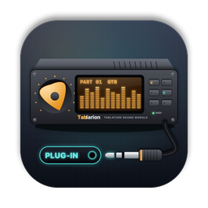
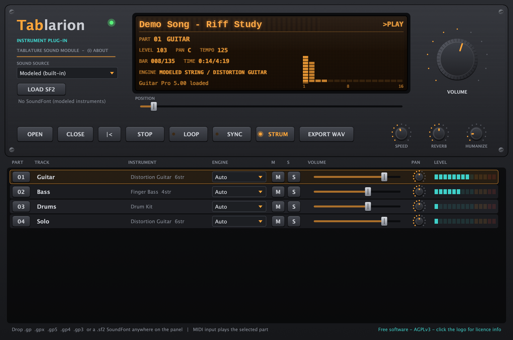

<p align="center">
  <a href="README.md">한국어</a> · <a href="README.en.md">English (US)</a> · <a href="README.en-GB.md">English (UK)</a> · <a href="README.zh-CN.md">简体中文</a> · <b>日本語</b> · <a href="README.fr.md">Français</a>
</p>

<p align="center">
  
</p>

<h1 align="center">Tablarion</h1>

<p align="center">
  Guitar Pro のタブ譜を演奏する macOS 用バーチャルインストゥルメント · VST3 / AU / Standalone<br>
  <a href="https://github.com/jayusop/Tablarion/releases/latest/download/Tablarion-macOS.zip"><b>⬇ 最新版をダウンロード</b></a> ·
  <a href="https://jayusop.github.io/Tablarion/?lang=ja">紹介ページ</a> ·
  <a href="https://github.com/jayusop/Tablarion-source">ソースコード</a>
</p>

<p align="center">
  
  
  
  
</p>

<p align="center">
  
</p>

---

Guitar Pro ファイル（.gp、.gpx、.gp5、.gp4、.gp3）を開き、**ハンマリング・スライド・チョーキング・ハーモニクス**などの奏法まで解釈して演奏する無料のバーチャルインストゥルメントです。弦ごとに独立した物理モデリングのギターとベース、ピアノ、オルガン、アンサンブル、合成ドラムキットを内蔵し、**すべての音はサンプルを使わずコードで合成**されます。

> 動作環境：macOS 12 以降 · ユニバーサルバイナリ（Apple Silicon / Intel でネイティブ動作）

## インストール

1. [Releases](https://github.com/jayusop/Tablarion/releases/latest) から `Tablarion-macOS.zip` をダウンロードして展開します。
2. 使う形式だけをコピーすれば OK です。Finder で <kbd>⌘⇧G</kbd> を押すとパスを指定してフォルダを開けます。

   | ファイル | コピー先 |
   |---|---|
   | `Tablarion.vst3` | `~/Library/Audio/Plug-Ins/VST3` |
   | `Tablarion.component` | `~/Library/Audio/Plug-Ins/Components`（Logic、GarageBand） |
   | `Tablarion.app` | `/Applications`（DAW なしで単体起動） |

3. Apple の公証を受けていない個人配布版のため、macOS が「壊れている」「開発元を確認できない」と警告します。ターミナルで隔離属性を削除してください。
   ```bash
   xattr -dr com.apple.quarantine ~/Library/Audio/Plug-Ins/VST3/Tablarion.vst3
   xattr -dr com.apple.quarantine ~/Library/Audio/Plug-Ins/Components/Tablarion.component
   xattr -dr com.apple.quarantine /Applications/Tablarion.app
   ```
4. DAW を再起動するかプラグインを再スキャンし、インストゥルメントトラックに **Tablarion** を挿入します。AU が表示されない場合は `auval -v aumu Tbln Tblr` で確認できます。

## 機能

| 分野 | 機能 |
|---|---|
| 楽譜 | 独自実装の GP3・GP4・GP5・GP6（.gpx）・GP7/8（.gp）リーダー。パネルへドロップまたは OPEN、CLOSE で閉じる |
| 奏法解釈 | リピートと括弧、テンポマップ、ハンマリング/プリング、スライド、チョーキングとアーム、ビブラート、ハーモニクス、トリル、トレモロピッキング、装飾音、ストローク（STRUM）、スウィング、ヒューマナイズ |
| 弦楽器 | 二重偏波ウェーブガイド物理モデル、弦ごとの独立ボイス、パームミュート、デッドノート、ピックアップ位置 |
| その他の楽器 | モーダルピアノ、FM エレピ、ドローバーオルガン、弦・金管アンサンブル、シンセ、ハイハットチョーク付き合成 GM ドラムキット |
| エフェクト | 4 倍オーバーサンプリングのアンプシミュとキャビネット、アコースティックボディ、コーラス、コンプレッサー、FDN ホールリバーブ、リミッター |
| SoundFont | SF2 バンクの読み込み（ボタン・ドラッグ＆ドロップ・自動読み込み）、Hybrid モード（ギターとベースはモデリング、その他は SF2）、トラックごとのエンジン選択 |
| DAW | SYNC でトランスポートとテンポに同期、MIDI 入力で選択パートを演奏、EXPORT WAV で曲全体を 24-bit WAV に書き出し |
| 練習 | 再生速度 25–200 %、ループ、位置移動、トラックごとのミュート・ソロ・音量・パン |

### Tablarion GM SoundFont（任意）

Tablarion 自身のモデリング楽器をレンダリングして作った General MIDI バンク（約 640 MB）です。128 の GM 音色と GM ドラムキットを収録し、サードパーティのサンプルは使用していません。[Releases](https://github.com/jayusop/Tablarion/releases/latest) から `Tablarion-GM.sf2` をダウンロードし、`~/Library/Application Support/Tablarion/SoundFonts` に置くと起動時に自動で読み込まれます。

## ソースコード

Tablarion はフリーソフトウェアで、ソースコード全体は **[jayusop/Tablarion-source](https://github.com/jayusop/Tablarion-source)** で公開しています。ビルド方法はソースリポジトリの README と[紹介ページ](https://jayusop.github.io/Tablarion/?lang=ja#build)を参照してください。

## ライセンス

**GNU Affero General Public License v3.0 以降（AGPL-3.0-or-later）** で配布される無料のフリーソフトウェアです。

- 個人・商用を問わず無料で使えます。**このプラグインで作った音楽やレンダリングしたオーディオは制作者のもの**で、ライセンス上の義務はありません。
- バイナリを再配布する場合は、対応するソースコード一式（またはそのリンク）と `LICENSE`、`THIRD_PARTY_LICENSES.txt` を一緒に提供する必要があります。
- 改変版も AGPL-3.0 でのみ配布でき、改変した旨を明記する必要があります。
- 「現状のまま」提供され、いかなる保証もありません。個人情報は収集しません。

AGPL を採用しているのは、Tablarion が JUCE フレームワーク（AGPLv3 を選択）と Steinberg VST3 SDK（GPLv3 を選択）で作られているためです。その他のサードパーティ製コンポーネント（Apple AudioUnitSDK、zlib、libpng、IJG libjpeg、FLAC、Ogg Vorbis、HarfBuzz、SheenBidi）はすべて寛容型ライセンスです。This software is based in part on the work of the Independent JPEG Group.

全文：[LICENSE](LICENSE)（英語原文）· [THIRD_PARTY_LICENSES.txt](THIRD_PARTY_LICENSES.txt) · [ライセンス詳細](https://jayusop.github.io/Tablarion/licenses.html)

VST は Steinberg Media Technologies GmbH の登録商標、Audio Units と macOS は Apple Inc. の商標、Guitar Pro は Arobas Music の商標、SoundFont は Creative Technology Ltd. の登録商標です。互換性の説明にのみ使用しており、Tablarion はこれらの企業と提携・承認関係のない独立したプロジェクトです。Guitar Pro のソフトウェア・コード・サウンドは含まれていません。

## お問い合わせ

- 不具合の報告・ご提案：[Issues](https://github.com/jayusop/Tablarion/issues) · メール jayusop@gmail.com
