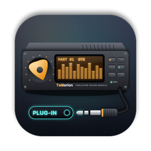
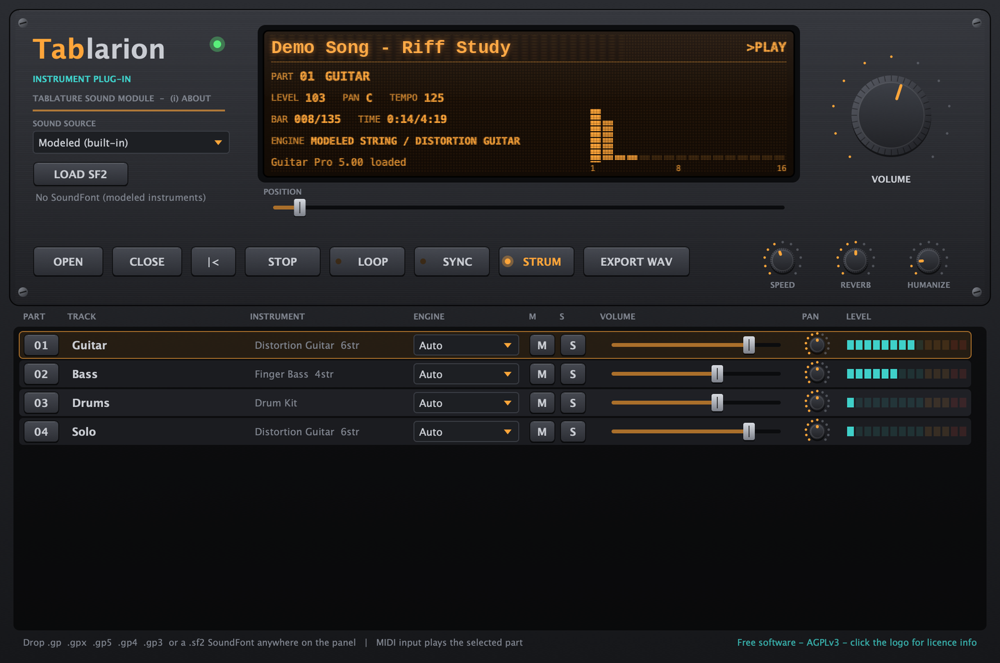

<p align="center">
  <b>한국어</b> · <a href="README.en.md">English (US)</a> · <a href="README.en-GB.md">English (UK)</a> · <a href="README.zh-CN.md">简体中文</a> · <a href="README.ja.md">日本語</a> · <a href="README.fr.md">Français</a>
</p>

<p align="center">
  
</p>

<h1 align="center">Tablarion</h1>

<p align="center">
  Guitar Pro 악보를 연주하는 macOS 가상 악기 · VST3 / AU / Standalone<br>
  <a href="https://github.com/jayusop/Tablarion/releases/latest/download/Tablarion-macOS.zip"><b>⬇ 최신 버전 다운로드</b></a> ·
  <a href="https://jayusop.github.io/Tablarion/">소개 페이지</a> ·
  <a href="https://github.com/jayusop/Tablarion-source">소스 코드</a>
</p>

<p align="center">
  
  
  
  
</p>

<p align="center">
  
</p>

---

Guitar Pro 파일(.gp, .gpx, .gp5, .gp4, .gp3)을 열어 **해머링·슬라이드·벤딩·하모닉스** 같은 주법까지 해석해 연주하는 무료 가상 악기입니다. 줄마다 독립된 물리 모델링 기타·베이스, 피아노·오르간·앙상블, 합성 드럼킷이 내장되어 있으며, **모든 소리는 샘플 없이 코드로 합성**됩니다.

> 요구 사항: macOS 12 이상 · 유니버설 바이너리 (Apple Silicon / Intel 네이티브)

## 설치

1. [Releases](https://github.com/jayusop/Tablarion/releases/latest)에서 `Tablarion-macOS.zip`을 내려받아 압축을 풉니다.
2. 쓰는 형식만 복사하면 됩니다. Finder에서 <kbd>⌘⇧G</kbd>로 폴더를 열 수 있습니다.

   | 파일 | 복사할 위치 |
   |---|---|
   | `Tablarion.vst3` | `~/Library/Audio/Plug-Ins/VST3` |
   | `Tablarion.component` | `~/Library/Audio/Plug-Ins/Components` (Logic, GarageBand) |
   | `Tablarion.app` | `/Applications` (DAW 없이 단독 실행) |

3. Apple 공증을 받지 않은 개인 배포판이라 macOS가 "손상되었거나 확인할 수 없는 개발자" 경고를 띄웁니다. 터미널에서 격리 속성을 지우세요.
   ```bash
   xattr -dr com.apple.quarantine ~/Library/Audio/Plug-Ins/VST3/Tablarion.vst3
   xattr -dr com.apple.quarantine ~/Library/Audio/Plug-Ins/Components/Tablarion.component
   xattr -dr com.apple.quarantine /Applications/Tablarion.app
   ```
4. DAW를 재시작하거나 플러그인을 다시 스캔한 뒤 악기 트랙에 **Tablarion**을 올립니다. AU가 보이지 않으면 `auval -v aumu Tbln Tblr`로 확인하세요.

## 기능

| 영역 | 기능 |
|---|---|
| 악보 | GP3·GP4·GP5, GP6(.gpx), GP7/8(.gp) 독자 구현 리더. 패널에 끌어다 놓거나 OPEN, CLOSE로 닫기 |
| 주법 해석 | 반복·다른 엔딩, 템포 맵, 해머링/풀링, 슬라이드, 벤딩·와미, 비브라토, 하모닉스, 트릴, 트레몰로, 꾸밈음, 스트로크(STRUM), 스윙, 휴머나이즈 |
| 현악기 | 이중 편광 웨이브가이드 물리 모델, 줄마다 독립 보이스, 팜뮤트·데드노트·픽업 위치 |
| 기타 악기 | 모달 피아노, FM 일렉트릭 피아노, 드로바 오르간, 현·관악 앙상블, 신스, 하이햇 초크가 있는 합성 GM 드럼킷 |
| 이펙트 | 4배 오버샘플링 앰프 시뮬과 캐비닛, 어쿠스틱 바디, 코러스, 컴프레서, FDN 홀 리버브, 리미터 |
| SoundFont | SF2 뱅크 불러오기(버튼·드래그 앤 드롭·자동 로드), Hybrid 모드(기타·베이스는 모델링, 나머지는 SF2), 트랙별 엔진 선택 |
| DAW | SYNC로 트랜스포트·템포 동기화, MIDI 입력으로 선택한 파트 연주, 곡 전체를 24-bit WAV로 내보내기 |
| 연습 | 재생 속도 25–200 %, 반복 재생, 위치 이동, 트랙별 뮤트·솔로·볼륨·팬 |

### Tablarion GM SoundFont (선택 사항)

Tablarion의 모델링 악기를 직접 렌더링해 만든 General MIDI 뱅크(약 640 MB)입니다. 128개 GM 악기와 GM 드럼킷이 들어 있고 제3자 샘플은 쓰지 않았습니다. [Releases](https://github.com/jayusop/Tablarion/releases/latest)에서 `Tablarion-GM.sf2`를 받아 `~/Library/Application Support/Tablarion/SoundFonts`에 넣으면 시작할 때 자동으로 불러옵니다.

## 소스 코드

Tablarion은 자유 소프트웨어이며 전체 소스 코드는 **[jayusop/Tablarion-source](https://github.com/jayusop/Tablarion-source)** 에 공개되어 있습니다. 빌드 방법은 소스 저장소의 README와 [소개 페이지](https://jayusop.github.io/Tablarion/#build)를 참고하세요.

## 라이선스

**GNU Affero General Public License v3.0 이상(AGPL-3.0-or-later)** 으로 배포되는 무료 자유 소프트웨어입니다.

- 개인·상업 작업 모두 무료로 쓸 수 있습니다. **이 플러그인으로 만든 음악과 렌더링한 오디오는 만든 사람의 것**이며 라이선스 의무가 없습니다.
- 바이너리를 재배포할 때는 대응하는 전체 소스(또는 그 링크)와 `LICENSE`, `THIRD_PARTY_LICENSES.txt`를 함께 제공해야 합니다.
- 수정본도 AGPL-3.0으로만 배포할 수 있으며, 수정했다는 사실을 밝혀야 합니다.
- "있는 그대로" 제공되며 어떠한 보증도 하지 않습니다. 개인정보를 수집하지 않습니다.

AGPL을 쓰는 이유는 JUCE 프레임워크(AGPLv3 선택)와 Steinberg VST3 SDK(GPLv3 선택)로 만들어졌기 때문입니다. 그 밖에 포함된 제3자 구성 요소(Apple AudioUnitSDK, zlib, libpng, IJG libjpeg, FLAC, Ogg Vorbis, HarfBuzz, SheenBidi)는 모두 허용형 라이선스입니다. This software is based in part on the work of the Independent JPEG Group.

전문: [LICENSE](LICENSE) (영어 원문) · [LICENSE.ko.md](LICENSE.ko.md) (한국어 안내) · [THIRD_PARTY_LICENSES.txt](THIRD_PARTY_LICENSES.txt) · [라이선스 상세 페이지](https://jayusop.github.io/Tablarion/licenses.html)

VST는 Steinberg Media Technologies GmbH의 등록 상표, Audio Units와 macOS는 Apple Inc.의 상표, Guitar Pro는 Arobas Music의 상표, SoundFont는 Creative Technology Ltd.의 등록 상표입니다. 호환성 설명을 위해서만 쓰이며, Tablarion은 이들 회사와 제휴하지 않은 독립 프로젝트입니다. Guitar Pro 소프트웨어·코드·사운드는 포함되어 있지 않습니다.

## 문의

- 버그 신고·제안: [Issues](https://github.com/jayusop/Tablarion/issues) · 메일 jayusop@gmail.com
