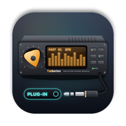
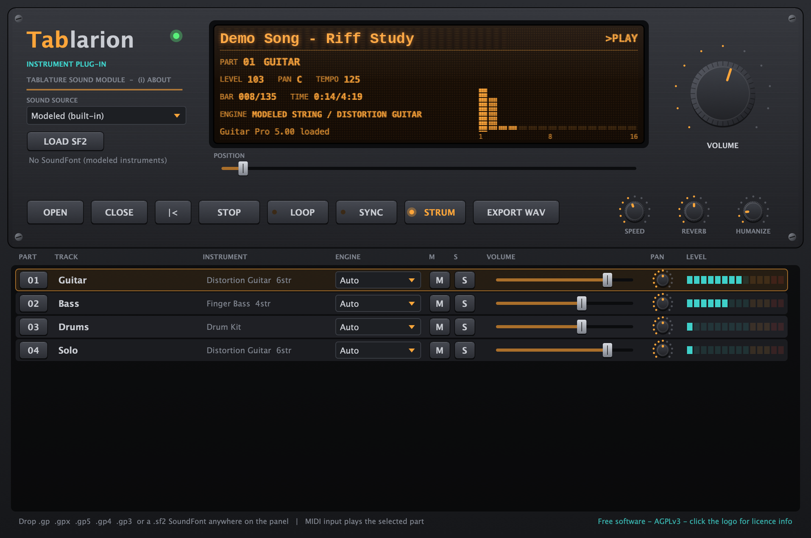

<p align="center">
  <a href="README.md">한국어</a> · <a href="README.en.md">English (US)</a> · <a href="README.en-GB.md">English (UK)</a> · <b>简体中文</b> · <a href="README.ja.md">日本語</a> · <a href="README.fr.md">Français</a>
</p>

<p align="center">
  
</p>

<h1 align="center">Tablarion</h1>

<p align="center">
  播放 Guitar Pro 曲谱的 macOS 虚拟乐器 · VST3 / AU / Standalone<br>
  <a href="https://github.com/jayusop/Tablarion/releases/latest/download/Tablarion-macOS.zip"><b>⬇ 下载最新版本</b></a> ·
  <a href="https://jayusop.github.io/Tablarion/?lang=zh">官网</a> ·
  <a href="https://github.com/jayusop/Tablarion-source">源代码</a>
</p>

<p align="center">
  
  
  
  
</p>

<p align="center">
  
</p>

---

一款免费的虚拟乐器：打开 Guitar Pro 文件（.gp、.gpx、.gp5、.gp4、.gp3），并解析**击弦、勾弦、滑音、推弦、泛音**等演奏技巧进行演奏。内置逐弦独立发声的物理建模吉他和贝斯、钢琴、风琴、合奏音色以及合成鼓组，**所有声音均由代码实时合成，不含任何采样**。

> 系统要求：macOS 12 或更高版本 · 通用二进制（在 Apple Silicon 和 Intel 上原生运行）

## 安装

1. 从 [Releases](https://github.com/jayusop/Tablarion/releases/latest) 下载 `Tablarion-macOS.zip` 并解压。
2. 只需复制你使用的格式。在访达中按 <kbd>⌘⇧G</kbd> 可按路径打开文件夹。

   | 文件 | 复制到 |
   |---|---|
   | `Tablarion.vst3` | `~/Library/Audio/Plug-Ins/VST3` |
   | `Tablarion.component` | `~/Library/Audio/Plug-Ins/Components`（Logic、GarageBand） |
   | `Tablarion.app` | `/Applications`（无需 DAW 即可独立运行） |

3. 这是未经 Apple 公证的个人发行版，macOS 会提示“已损坏”或“无法验证开发者”。请在终端中清除隔离属性：
   ```bash
   xattr -dr com.apple.quarantine ~/Library/Audio/Plug-Ins/VST3/Tablarion.vst3
   xattr -dr com.apple.quarantine ~/Library/Audio/Plug-Ins/Components/Tablarion.component
   xattr -dr com.apple.quarantine /Applications/Tablarion.app
   ```
4. 重启 DAW 或重新扫描插件，然后在乐器轨道上加载 **Tablarion**。如果看不到 AU，可用 `auval -v aumu Tbln Tblr` 检查。

## 功能

| 类别 | 功能 |
|---|---|
| 曲谱 | 自主实现的 GP3、GP4、GP5、GP6（.gpx）、GP7/8（.gp）读取器。拖放到面板或点击 OPEN，CLOSE 关闭 |
| 技巧解析 | 反复与跳房子、速度变化、击勾弦、滑音、推弦与摇把、颤音、泛音、颤音奏法、震音拨弦、倚音、扫弦（STRUM）、摇摆、人性化 |
| 弦乐器 | 双偏振波导物理模型，逐弦独立发声，闷音、死音、拾音器位置 |
| 其他乐器 | 模态钢琴、FM 电钢琴、拉杆风琴、弦乐与铜管合奏、合成器，带踩镲闭合的合成 GM 鼓组 |
| 效果器 | 4 倍过采样音箱模拟与箱体、原声琴体共鸣、合唱、压缩器、FDN 大厅混响、限制器 |
| SoundFont | 加载 SF2 音色库（按钮、拖放或自动加载），Hybrid 模式（吉他和贝斯用建模，其余用 SF2），可按轨道选择引擎 |
| DAW | SYNC 同步走带与速度，MIDI 输入演奏所选声部，EXPORT WAV 将整首曲子渲染为 24-bit WAV |
| 练习 | 速度 25–200 %、循环、跳转位置、按轨道静音/独奏/音量/声像 |

### Tablarion GM SoundFont（可选）

由 Tablarion 自身的建模乐器渲染而成的 General MIDI 音色库（约 640 MB），包含 128 种 GM 乐器和 GM 鼓组，未使用任何第三方采样。从 [Releases](https://github.com/jayusop/Tablarion/releases/latest) 下载 `Tablarion-GM.sf2`，放入 `~/Library/Application Support/Tablarion/SoundFonts`，启动时会自动加载。

## 源代码

Tablarion 是自由软件，完整源代码公开在 **[jayusop/Tablarion-source](https://github.com/jayusop/Tablarion-source)**。构建方法请参阅源代码仓库的 README 和[官网](https://jayusop.github.io/Tablarion/?lang=zh#build)。

## 许可证

以 **GNU Affero 通用公共许可证 v3.0 或更高版本（AGPL-3.0-or-later）** 发布的免费自由软件。

- 个人与商业用途均可免费使用。**用本插件创作的音乐和渲染的音频归创作者所有**，不附带任何许可证义务。
- 再分发二进制文件时，必须同时提供完整的对应源代码（或其链接）以及 `LICENSE`、`THIRD_PARTY_LICENSES.txt`。
- 修改版只能以 AGPL-3.0 发布，并须注明已修改。
- 按“原样”提供，不作任何担保。不收集个人信息。

采用 AGPL 是因为 Tablarion 基于 JUCE 框架（选择 AGPLv3）和 Steinberg VST3 SDK（选择 GPLv3）构建。其他第三方组件（Apple AudioUnitSDK、zlib、libpng、IJG libjpeg、FLAC、Ogg Vorbis、HarfBuzz、SheenBidi）均为宽松许可证。This software is based in part on the work of the Independent JPEG Group.

全文：[LICENSE](LICENSE)（英文原文）· [THIRD_PARTY_LICENSES.txt](THIRD_PARTY_LICENSES.txt) · [许可证详情](https://jayusop.github.io/Tablarion/licenses.html)

VST 是 Steinberg Media Technologies GmbH 的注册商标，Audio Units 和 macOS 是 Apple Inc. 的商标，Guitar Pro 是 Arobas Music 的商标，SoundFont 是 Creative Technology Ltd. 的注册商标。这些名称仅用于说明兼容性；Tablarion 是独立项目，与上述公司无关联，也未获其认可。不包含任何 Guitar Pro 软件、代码或声音。

## 联系方式

- 错误报告与建议：[Issues](https://github.com/jayusop/Tablarion/issues) · 邮件 jayusop@gmail.com
